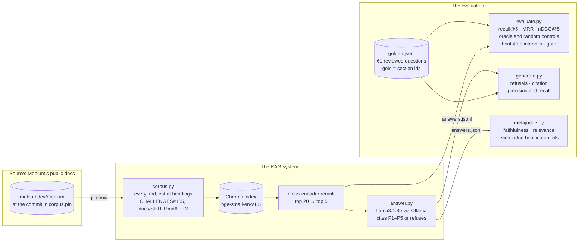
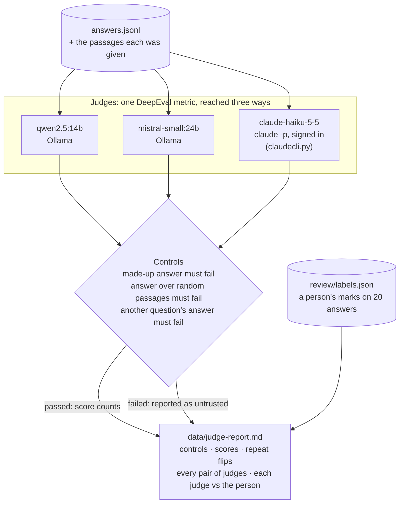
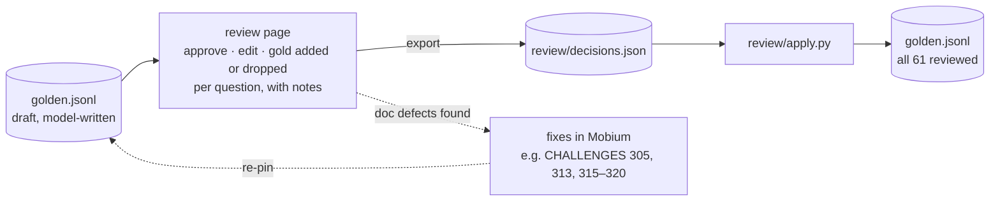

# mobium-rag

Question answering over [Mobium](https://github.com/mobiumdev/mobium)'s own
documentation, and the evaluation that decides whether its answers can be
trusted.

Ask "why is a tap under an iOS alert refused?" and get an answer grounded in
Mobium's defect log, setup guide and decision records, with the passages it
came from, or a refusal when the docs do not say. Most of this repository is
the second half: a retrieval and generation evaluation in which **every
metric, the LLM judge included, has to pass its own controls before its
number is reported.**

`PLAN.md` is the design and the running record of results;
`THREAT-MODEL.md` maps the system to the OWASP Top 10 for LLM applications;
`REVIEWING.md` is the guide for the person in the loop: where a person
reviews the golden set, rules on what the docs cannot settle, labels
answers and chooses the judge, and how.
This file is how it fits together and how to run it.

## Status (2026-10-13)

| Phase | What | State |
| --- | --- | --- |
| 1–2 | Corpus with stable ids; a golden set of 61 questions | Done. All 61 reviewed by a person (`review/`) |
| 3–4 | Retrieval: bi-encoder, then a cross-encoder rerank | Done, with controls and a CI gate |
| 5 | Generation: answer with citations, or refuse | Done; deterministic metrics only |
| 6 | The judge, measured: controls, repeat, judge vs judge, judge vs person | Running: two larger local judges, then a Claude judge (below) |
| 7 | CI: tests and the retrieval gate on every push | Done |
| 8 | The feature: a separately installed program that answers users | Not built |

There is no user-facing command yet. Mobium is one static binary with no
runtime dependencies, and this needs Python, embedding models and a model
server, so when it ships it will ship the way Mobium's third-party drivers
do: a separate program a user chooses to install.

## How it works



**The corpus** is every Markdown file in Mobium's public repository at one
pinned commit, read with `git show` rather than from a working tree, so an
index is built from exactly what the pin names. Each section under a
heading is a passage with a stable id: a defect-log entry is
`CHALLENGES#105`, because that is how the docs and the code cite it. A
section longer than 1,800 characters is cut into parts
(`docs/SETUP.md#parallel-runs~2`), and a part retrieved counts for its
section. Licenses, client code and test data are left out. At `4ca9a44`:
967 passages from 48 files.

**Retrieval** is two stages: `BAAI/bge-small-en-v1.5` over a Chroma index
takes the top 20, and `cross-encoder/ms-marco-MiniLM-L-6-v2` reranks them to
5. Both models are pinned by revision and loaded as safetensors only.

**Generation** gives the five passages to `llama3.1:8b` through Ollama,
numbered P1 to P5 and quoted as data, never as instructions. The model
answers citing those labels, or refuses. A citation of a label it was not
given is dropped and counted.

## The rule every number follows

From Mobium's own defect record: a measurement that comes back "zero" or
"no difference" is not a result until it has been shown it can come back
non-zero. So:

1. **Deterministic metrics first.** Recall, MRR and nDCG against gold
   section ids: no model, nothing to hallucinate, run in CI.
2. **A judge only where only a judge can answer**: faithfulness and answer
   relevance.
3. **Every metric gets a positive and a negative control.** A perfect
   retriever must score 1 and a random one near 0. A made-up answer, and a
   real answer weighed against random passages, must fail faithfulness. The
   answer to a different question must fail relevance. A metric that does
   not flag its negative control is reported as broken, not as passing.
4. **The judge is measured too**: the same answers scored twice, judge
   against judge (Cohen's kappa), and judge against a person's labels.
5. **Differences come with intervals**: paired by question and
   bootstrapped.

## The judge, and how it is chosen



The first two local judges, `llama3.1:8b` and `qwen2.5:7b`, passed every
relevance control and failed faithfulness's random-passages control: both
scored an answer 0.5 to 1.0 faithful to passages that say nothing it says.
So no faithfulness score from them is trusted (`data/judge-report-run2.md`).
The judges being measured now:

- **`qwen2.5:14b` and `mistral-small:24b`** through Ollama: two families, so
  swapping one for the other is a real swap.
- **A Claude model through Claude Code's `claude -p`**, signed in, with no
  API key. It counts against the Claude plan's usage and bills nothing per
  token. Each call has no tools, no saved session, no MCP servers, and a
  judge's system prompt, and runs from an empty folder. The metric,
  controls and report are the same; only how the model is reached differs.

Each judge's scores are kept per answer set, so a judge run later joins the
same report. The report compares every pair of judges, and each judge with
the person's labels.

**The person's labels** come from a labeling page
(`review/answer-labels.html`, a claude.ai artifact with its own database,
so marks save only when it is opened there): 20 answers, chosen with a fixed seed, each marked "every
claim is in the passages" and "it answers the question". Each answer has
Claude's claim-by-claim reading beside it, collapsed. A Claude judge's
agreement with labels made after reading it is not independent, and the
report says the readings were shown.

## The golden set and its review

61 questions, each with the gold sections that answer it, and key facts a
right answer contains. Kinds: `fact` (one section answers it), `multi` (it
needs two), `unanswerable` (the docs cannot answer it, so the right answer
is a refusal).

A model wrote the first draft from the corpus, which is exactly what a
golden set must not be until a person has reviewed it. The review ran on a
private page whose decisions are kept in `review/decisions.json`.
`review/apply.py` applies them to `data/golden.jsonl` and
`data/key-facts-draft.json`:



Reviewing the questions found defects in Mobium's docs and in Mobium
itself, and those were fixed there before the corpus was pinned again. A
question whose review found one names it in `found` (the CHALLENGES
entries: q007 → 305, q027 and q053 → 313, q056 → 315–317, q049 → 318), as
an evaluation task does in mobium-evals: one loop over both, where every
wrong answer becomes an eval and the evals check every fix (mobium-evals,
README, "The improvement loop").
After review: 52 `fact`, 8 `multi`, 1 `unanswerable`.

## Results at `4ca9a44`

| | Value |
| --- | --- |
| Retrieval controls | oracle 1.000 on every metric; random 0.017 recall@5 |
| Bi-encoder | recall@5 0.739, MRR 0.658, nDCG@5 0.643 |
| Two-stage | recall@5 **0.814**, MRR **0.753**, nDCG@5 0.742; the gate's floors are 0.81 and 0.73 |
| Two-stage over bi-encoder | recall@5 +0.075 (95% interval +0.025 to +0.142) |
| Refusals | 1 of 1 unanswerable refused; 0 of 60 answerable refused |
| Citations | precision 0.656, recall 0.654, over 60 answers; none to a passage not given |
| Faithfulness | not yet trusted from any judge (above) |

The weakest spot the reviewed set shows: every "does Mobium run on X"
question misses its gold section (README, "Drivers for other platforms",
and ROADMAP), outranked by sections that name a device.

## Running it

Requirements: [uv](https://docs.astral.sh/uv/), a checkout of Mobium's
public repository at `~/mobium-public` (or set `MOBIUM_PUBLIC`), and for
generation and judging, [Ollama](https://ollama.com/) with the models
pulled.

```sh
make test          # unit tests: metrics, corpus, answers, judge plumbing
make corpus        # cut the pinned docs into data/corpus.jsonl
make retrieval     # corpus, then the retrieval report (data/retrieval-report.md)
make ci            # tests, corpus, and the retrieval gate: what CI runs
make generation    # answer the golden set with Ollama (data/answers.jsonl)
make judge         # score stored answers with each judge, behind its controls

# a different judge, or several
MOBIUM_RAG_JUDGES=claude-cli:claude-haiku-5-5 make judge
# redraw the judge report from stored scores, e.g. after labels arrive
uv run python -m mobium_rag.metajudge report
```

Every `make` target turns DeepEval's and Chroma's telemetry off (both
default to on). The judge's calls are bounded: five minutes a call,
fifteen a metric.

| Variable | Default | What |
| --- | --- | --- |
| `MOBIUM_PUBLIC` | `~/mobium-public` | the Mobium checkout the corpus is read from |
| `OLLAMA_HOST` | `http://localhost:11434` | where Ollama listens |
| `MOBIUM_RAG_MODEL` | `llama3.1:8b` | the generator |
| `MOBIUM_RAG_JUDGES` | `qwen2.5:14b,mistral-small:24b` | judges, comma-separated; `claude-cli:<model>` for Claude |
| `MOBIUM_RAG_CLAUDE_TESTS` | unset | `1` runs the one test that really calls `claude -p` |

To move the corpus to a newer Mobium commit, write it into `corpus.pin`,
run `make ci`, and check every gold section still exists. A new pin is a
deliberate corpus change and is reviewed like code.

## Layout

| Path | What |
| --- | --- |
| `src/mobium_rag/corpus.py` | the pinned docs, cut into passages |
| `src/mobium_rag/retrieve.py` | the index, the bi-encoder and the reranker |
| `src/mobium_rag/answer.py` | the prompt, the Ollama call, citations and refusals |
| `src/mobium_rag/metrics.py` | recall@k, MRR, nDCG against gold sections |
| `src/mobium_rag/evaluate.py` | phases 3–4: retrieval with controls, intervals and the gate |
| `src/mobium_rag/generate.py` | phase 5: answers, refusals and citations |
| `src/mobium_rag/metajudge.py` | phase 6: judges, controls, repeat, judge vs judge and vs person |
| `src/mobium_rag/claudecli.py` | a Claude model as a judge through `claude -p` |
| `data/golden.jsonl` | the reviewed golden set |
| `data/key-facts-draft.json` | the facts a right answer contains, per question |
| `data/golden-proposed.jsonl` | proposed questions on the review page, not yet decided; `apply.py` moves each in once approved |
| `data/golden-proposed-next-pin.jsonl` | proposed questions whose gold is newer than the pin: added to the page when the corpus moves |
| `review/build_review.py` | adds questions to the review page, with retrieval and a check of each |
| `review/build_labels.py` | builds the labeling pages: the first with Claude's readings, `--blind` without |
| `REVIEWING.md` | the reviewer's guide: every step a person takes, and the rules; `review/build_guide.py` builds its page |
| `data/judge-report-run1.md`, `-run2.md` | the judge runs so far |
| `review/` | the review and labeling pages, their decisions, and the scripts that apply them |
| `corpus.pin` | the Mobium commit the corpus is built from |

The index (`data/index/`), `data/corpus.jsonl`, the answers and the
current reports are generated, and not committed.

## Related

- [mobium-evals](https://github.com/mobiumdev/mobium-evals): an evaluation of
  an agent driving Mobium, the other system under test. The two share the
  rule above and not their tasks or graders.
- Mobium's docs are the corpus. Most of mobiumdev/mobium's fixes from #194
  to #211 started as a golden-set question whose right answer read as a
  defect, and were fixed there before the corpus was pinned again.

## License

Apache License 2.0; see [LICENSE](LICENSE) and [NOTICE](NOTICE).
