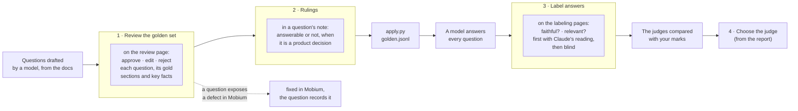

# Reviewing: where a person steps in

The evaluation in this repository is measurement, and its numbers mean
something only where a person has checked what they rest on. A model wrote
the first golden questions, a model answers them, and models judge the
answers. A person decides what counts as a right question, a right answer
and a good judge. This guide is for that person: where you step in, what
you are looked to for, and how to do it.

This guide is also a page, built from this file by `review/build_guide.py`.

You need no code and no terminal. Everything you do happens on three
private pages, and each choice saves as you make it. The maintainer runs
the commands that bring your choices into the repository.

## Where you step in

| Step | Where | What you decide | Then |
| --- | --- | --- | --- |
| 1. Review the golden set | The golden review page | Each question: approve, edit or reject; which sections answer it; what a right answer must say | `review/apply.py` writes your decisions into `data/golden.jsonl` |
| 2. Rule on what the docs cannot settle | A note on the question | Whether a question has an answer at all, when that turns on a product decision rather than on the docs | The question becomes a fact question or stays unanswerable |
| 3. Label answers | The labeling pages, first and blind | For each answer: is every claim in its passages, and does it answer the question | `python -m mobium_rag.metajudge report` compares every judge with your marks |
| 4. Choose the judge | The report | Which judge's scores to trust, from its controls and its agreement with you | PLAN.md records the choice and why |

Nothing a model wrote counts until a person has reviewed it. A question
left undecided stays out of the set; a judge that disagrees with you is
not trusted however well it scores.

## 1. Reviewing the golden set

### What a golden question is

A golden question is a test: a question a user could ask, the sections of
Mobium's docs that answer it, and the facts a right answer must state.
Retrieval is scored by whether it finds the gold sections; an answer is
checked against the key facts.

- **The corpus is Mobium's public docs at one pinned commit** (`corpus.pin`).
  A question is answered from that version of the docs, not from what
  you know of Mobium today.
- **A section is a heading and what is under it.** A gold label names one,
  as `CHALLENGES#305` (an entry in the defect log) or
  `docs/SETUP.md#parallel-runs`.
- **Three kinds:**
  - **Single fact** (`fact`): one section answers it.
  - **Two sections** (`multi`): it needs two; neither answers it alone.
  - **Not in the docs** (`unanswerable`): the docs do not answer it, and
    the right answer says so and refuses.

### Reading a question card

Each question on the review page is one card:

- **The header**: its id; its kind; **Missed by retrieval** when none of
  the top five is a gold section; **New · retrieved at …** for a question
  added later, with the pin its retrieval was run at; and its state,
  Undecided, Approved, Edited or Rejected.
- **The question**, as a user would ask it.
- **The answer key** (left): the gold sections, each with its heading and
  an excerpt under **Read the passage**.
- **Retrieved, reranked top 5** (right): what the retriever found for this
  question, best first, with the gold ones marked **Answer key**. Under
  any other one, **Also answers it** adds it to the gold.
- **Key facts a correct answer must state**: drafted first, then yours.
  Edit freely, one fact per line; **Facts look right** keeps them as shown.
- **Drafting flagged** (orange): a doubt raised when the question was drafted.
- **Claude checked it** (blue): Claude's reading of the question against
  the docs and the code, ending in a proposal. It is a proposal, never a
  decision: the buttons below are the decision, and they are yours.
- **Approve, Edit, Reject**, then a **Note**.

### How to decide

Ask, in this order:

1. **Would a real user ask it, in these words?** A question should not copy
   a doc's wording, or retrieval is tested on matching words, not meaning.
   One drafted question repeated a defect's "Found by" line almost word for
   word; it was reworded.
2. **Do the gold sections answer it?** Open each passage. If a gold section
   does not answer it, say so in the note. If a retrieved one does, tick
   **Also answers it**.
3. **Is it right at this pin?** A question whose answer a later change
   replaced is wrong, not hard: "which button does accept press" had one
   answer before CHALLENGES 305 and another after. Edit it to ask what is
   true now, or reject it.
4. **Are the key facts what a right answer must say, and all true?** Keep
   them few, short and checkable: two or three. Each should be stated in
   a gold section.
5. **Is the kind right?** Two sections needed is `multi`; the docs silent
   is `unanswerable`.

Then:

- **Approve** when the question, its gold and its facts are right as shown.
- **Edit** when the question's wording or facts need a change: edit the
  question in the box that opens, and the facts in theirs.
- **Reject** when it cannot be fixed: a duplicate, a premise that is false,
  a question nobody would ask. A rejected question leaves the set.
- **Note** anything the buttons cannot say: a gold section to drop, a kind
  to change, a ruling (below). Start such a line with what to do — "DROP
  CHALLENGES#55 from gold", "kind fact" — so it is carried out exactly; the
  maintainer copies each into `review/apply.py`'s tables.

**A question missed by retrieval is not a bad question.** It is what the
golden set is for. Approve it if it is right; the miss is retrieval's.

### When a question finds a defect in Mobium

Reviewing a question sometimes shows the docs or Mobium wrong: a passage
that says one thing while the code does another, a refusal whose remedy
cannot work. Say so in the note. It is fixed in Mobium, the corpus is
pinned past the fix, and the question records the defect it found in
`found` (as q007 → CHALLENGES 305). That is the inner loop of
mobium-evals' README, "The improvement loop": every wrong answer becomes an
eval, and the evals check every fix.

## 2. Rulings the docs cannot settle

Some questions turn on a product decision the docs do not record:

- "Can Mobium automate a Tizen TV?" The docs have no Tizen driver, but say
  anyone can write one. **Ruling (2026-10-12): answerable**, a fact question
  whose gold is the driver guide. HarmonyOS, KaiOS, BlackBerry and a car's
  head unit took the same ruling.
- "Is there an enterprise license?" A paid offering is planned and not
  written down. **Ruling: kept unanswerable**, so the right answer is that
  the docs name none, until the docs say otherwise.

Write a ruling in the question's note, with the date and a line of why. A
ruling that a doc should say something becomes a change to Mobium's docs,
and the question waits for the corpus to be pinned past it.

## 3. Labeling answers

The judges score each answer for **faithfulness** and **relevance**. Your
labels are what a judge is measured against: a judge that disagrees with
you is not trusted.

### The two marks

**Is every claim in the passages?** Could every statement in the answer
be backed up by pointing at the passages beside it? This is whether the
answer sticks to its sources, not whether it is right.

1. Split the answer into its claims, each separate statement of fact.
2. Look for each claim in the passages. It counts if a passage says it, or
   plainly means it in other words.
3. **Yes** only if every claim is found. **No** if even one is not.

**The rule that trips people up:** No for anything the passages do not say,
even if it is true of Mobium. The test is whether the answer kept to what
it was given. An answer that brings in outside facts is guessing, even when
it guesses right.

| Situation | Mark | Why |
| --- | --- | --- |
| A claim is in a passage that is out of date, and a newer passage says otherwise | **Yes** | It is supported; being wrong today is not a faithfulness failure |
| A claim contradicts its passage | **No** | |
| The answer stretches a passage past what it says | **No** | "MobiumApp's demo is no slider on iOS" is not "iOS sliders are not sliders" |
| Two true halves joined into a cause the passage does not give | **No** | Giving the fix as the reason the bug happened |
| Thin, but everything it says is in a passage | **Yes** | Incomplete is not unfaithful |
| "The docs do not say" | **Yes** | It claims nothing the passages lack |
| Off-topic but accurate to the passages | **Yes** | The second mark catches it |

**Does it answer the question?** Yes if it addresses what was asked, right
or wrong. The two marks are separate: an answer can be faithful and miss
the question, or answer it unfaithfully.

The passages are numbered P1 to P5 beside each answer; a `[P2]` in the
answer opens that passage. A note is optional: what was wrong, or why it
was close.

### Two labeling pages, and why the second is blind

- **The first page** shows, under each answer, Claude's claim-by-claim
  reading of it, collapsed. It saves time, and it couples your marks to
  Claude's reading: a Claude judge that agrees with you may be agreeing
  with Claude.
- **The blind page** shows no reading of Claude's anywhere. Its twenty
  answers are others, chosen with another seed. The report compares each
  judge with every label, with the first set and with the blind set on its
  own, so the coupling is measured rather than guessed at.

On the blind page: **mark each answer before asking anyone, Claude
included, about it.** Afterwards, ask whatever you like.

## 4. Choosing the judge

`python -m mobium_rag.metajudge report` writes `data/judge-report.md`. A
judge is trusted for a metric only if:

1. **It passes every control.** A made-up answer, and a real answer
   weighed against random passages, must fail faithfulness; another
   question's answer must fail relevance. A judge that fails one is
   reported as untrusted for that metric, whatever it scores.
2. **It is repeatable.** The same answers scored again should not flip
   between pass and fail.
3. **It agrees with you**, most of all on the blind labels.

The choice and its reasons go in PLAN.md, phase 6.

## What the maintainer does with your work

| After | The maintainer runs | Which |
| --- | --- | --- |
| Reviewing questions | the page's database exported to `review/decisions.json`, then `uv run python review/apply.py` | moves approved and edited questions in, removes rejected ones, keeps undecided ones proposed |
| A batch of new questions | `uv run python review/build_review.py <questions.jsonl> <checks.json>` | puts them on the review page, with retrieval and a check of each |
| Labeling | each page's `labels` exported to `review/labels.json` and `review/labels-blind.json`, then `uv run python -m mobium_rag.metajudge report` | compares every judge with your marks, nothing scored again |
| Any of these | `make ci` | the tests and the retrieval gate on the golden set as it now stands |

## The rules, in short

- Nothing a model wrote counts until a person has reviewed it.
- A question is answered from the docs at the pinned commit, not from
  memory of Mobium.
- Claude's checks are proposals. Your buttons are the decisions.
- Faithful means supported by the passages shown, not true.
- On the blind page, mark first, discuss after.
- A question that finds a defect is a good question: note it.
